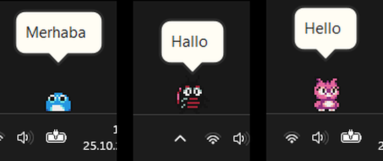
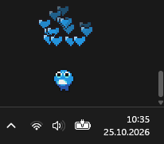
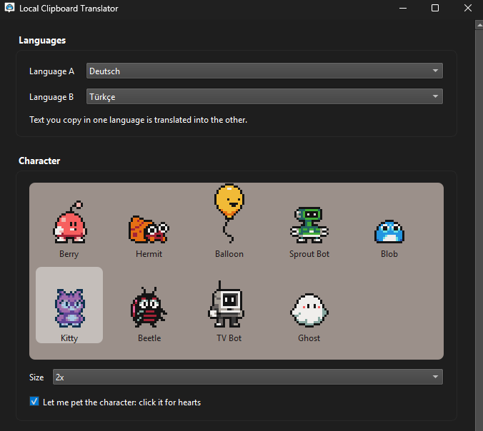
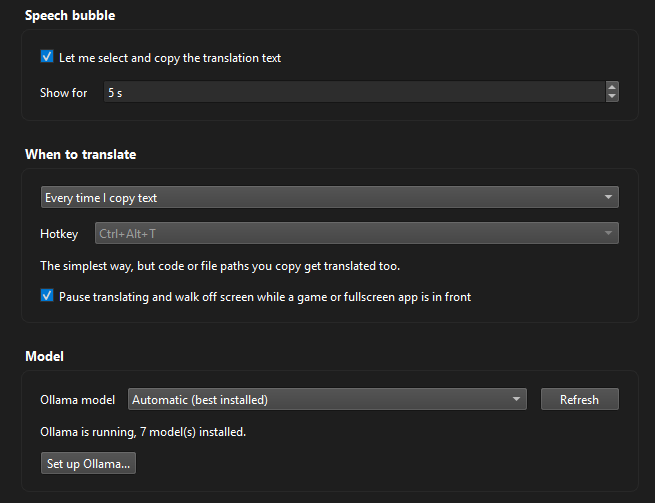
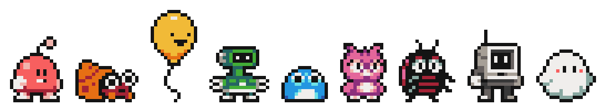

<div align="center">


# Local Clipboard Translator

A tiny pixel character that lives on your Windows taskbar and translates whatever you copy.
Everything runs locally through [Ollama](https://ollama.com): no cloud, no API keys, no subscription.

</div>

- **Type**: Windows desktop app (system tray and taskbar character)
- **Stack**: Python 3.14, PySide6 (Qt 6), no other runtime dependency
- **Model runtime**: Ollama, local only; default model `gemma2:9b`
- **Languages**: Turkish, German, English (pick any two, bidirectional)
- **License**: MIT
- **Status**: v0.1.0, first public release

## Demo

<p align="center">
  
</p>

Copy some text in one language and a speech bubble appears above the character with the translation in the other. The app lives in the system tray with a settings window and ships as a normal Windows installer.

<p align="center">
  
</p>

Click a character to pet it. The more you click, the more hearts, until it gets overwhelmed and dashes off.

## Screenshots

<p align="center">
  
  
</p>

Supported languages: Turkish, German and English. You pick any two, and text in either one is translated into the other.

## Characters

<p align="center">
  
</p>

Nine characters to choose from: Berry, Hermit, Balloon, Sprout Bot, Blob, Kitty, Beetle, TV Bot and Ghost. Sprites by [GrafxKid](https://opengameart.org/content/various-creatures), released under CC0.

## Features

- **Local and private.** Translation runs on your machine through Ollama. The app talks only to `127.0.0.1`. Nothing you copy leaves the computer, and clipboard entries flagged by a password manager are ignored.
- **Nine characters.** Berry, Hermit, Balloon, Sprout Bot, Blob, Kitty, Beetle, TV Bot and Ghost. Each strolls, stops, turns and fidgets, with its own quirks (Kitty flies, Hermit hides in its shell when idle, Balloon floats). Four sizes.
- **Pet them.** Click a character for hearts. Keep clicking and it gets overwhelmed and dashes off.
- **Speech bubble.** Streams the translation in, fades out on its own, closes on click. Long text is split and scrolls upward like end credits.
- **Trigger modes.** Translate on every copy, only when you copy the same text twice, or with a global hotkey.
- **Stays out of the way.** When a game, fullscreen video or presentation is in front, translating pauses and the character walks off screen, then walks back afterwards.
- **Setup wizard.** If Ollama or a model is missing, the app offers to download and install them for you, asking before every download.
- **History.** The last 20 translations are in the tray menu, kept in memory only and never written to disk.
- **Interface** in English or Turkish.

## Install

1. Download `LocalClipboardTranslator-Setup.exe` from the [latest release](../../releases/latest).
2. Run it. Windows SmartScreen will warn about an unknown publisher because the installer is not code signed: click **More info**, then **Run anyway**.
3. On first run the app checks for Ollama and a model, and offers to install them if they are missing (Ollama is about 1.6 GB, the default model about 5.4 GB).

No administrator rights are required. Settings and the log are removed on uninstall.

## Antivirus note

This app is packaged with PyInstaller and Inno Setup. Microsoft Defender's machine-learning heuristic may flag the installer as `Trojan:Win32/Wacatac.B!ml`. This is a known false positive for PyInstaller builds, not a real detection: the app is built from the source in this repository, talks only to a local Ollama on `127.0.0.1`, and makes no other network connection.

VirusTotal scan of the installer: [1 of 68, heuristic only](https://www.virustotal.com/gui/file/3729bf4606af5a78a683bbf27e3b47fff9b241559097c45339c3bfe3b70835cd). If in doubt, build it yourself from source (see below), or report the false positive to Microsoft at [microsoft.com/wdsi/filesubmission](https://www.microsoft.com/wdsi/filesubmission).

## Translation quality

Quality depends on the model and the text. Everyday sentences and technical wording are handled well. The weak spot is very short input: single-word lookups and two-word phrases are sometimes translated or detected poorly. The default model is `gemma2:9b`; you can switch to any other installed Ollama model in the settings, and a larger or newer model usually helps with the hard cases.

Ollama and the language model are separate downloads with their own licenses. The app does not bundle them.

## Run from source

Requires Python 3.14 and a running Ollama.

```
python -m venv .venv
.venv\Scripts\pip install -e .
.venv\Scripts\python -m lct
```

Compare models on sample texts, without the GUI:

```
.venv\Scripts\python tools\try_translate.py gemma2:9b qwen3:8b
```

## Build the installer

```
powershell -ExecutionPolicy Bypass -File packaging\build.ps1
```

This installs the build extras, regenerates the icon, runs PyInstaller (one folder) and, if [Inno Setup 6](https://jrsoftware.org/isinfo.php) is installed, produces `dist\LocalClipboardTranslator-Setup.exe`.

## How it is built

Python 3.14 with PySide6 (Qt 6). The only runtime dependency is PySide6; the Ollama client uses the standard library. Source lives in `src/lct/`.

## Credits

- Character sprites: **Various Creatures** by **GrafxKid**, [OpenGameArt](https://opengameart.org/content/various-creatures) (CC0).
- Local model runtime: [Ollama](https://ollama.com).
- Default model: Google [Gemma 2](https://ai.google.dev/gemma), used under the Gemma Terms of Use.
- UI framework: [Qt for Python (PySide6)](https://doc.qt.io/qtforpython/), LGPL.

Full third-party licenses are listed in [`THIRD_PARTY_NOTICES.md`](THIRD_PARTY_NOTICES.md).

## License

[MIT](LICENSE) © 2026 Metin Berkay Şen

## Known limitations

- Windows only, and the character walks along the bottom of the primary monitor.
- Three languages for now.
- `gemma2:9b` is split between GPU and CPU on an 8 GB graphics card.
- The installer is not code signed, so SmartScreen warns on first run.

## Key takeaway

A useful desktop tool can be fully local and free. A small PySide6 front end plus a local model through Ollama replaces a cloud translation service, and nothing you copy ever leaves the machine. The hard part was not the translation but the desktop integration: a click-through taskbar window that does not fight the cursor, honest handling of the model's load time, and settings that do not silently outlive an uninstall.
